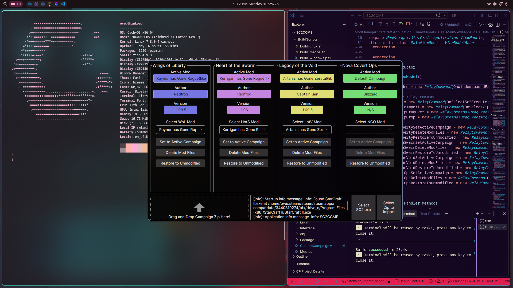
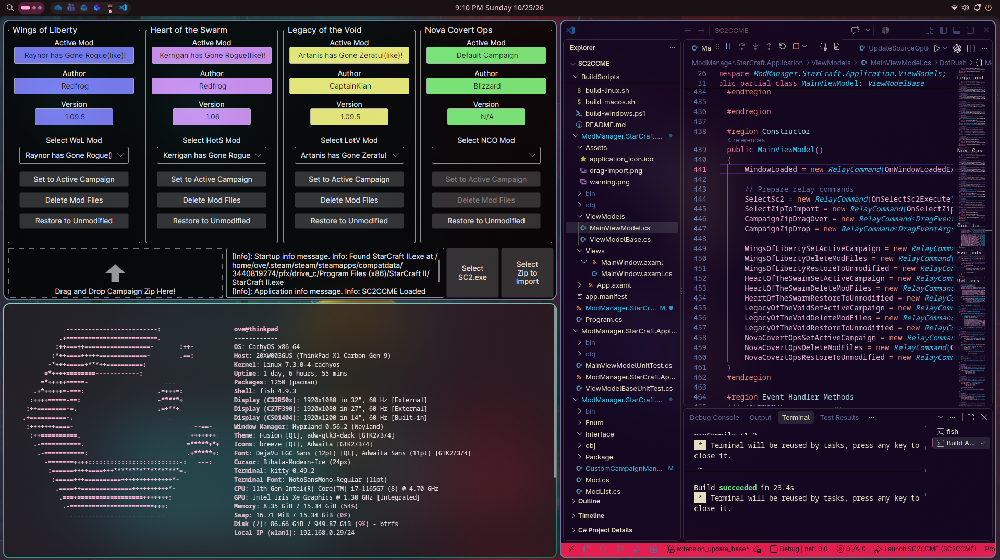

# SC2CCME - StarCraft 2 Custom Campaign Manager Extended
**Maintainer:** Andrew Oveson

<p align="center">
  <!-- CI/CD & Testing -->
  <a href="https://github.com/aoveson/SC2CCME/actions/workflows/release.yml"></a>
  <a href="https://github.com/aoveson/SC2CCME/actions"></a>
  <a href="https://github.com/aoveson/SC2CCME/releases/latest"></a>
  <a href="https://github.com/aoveson/SC2CCME/releases"></a>
</p>

<p align="center">
  <!-- Tech Stack & Platforms -->
  
  
  
  
  <a href="https://github.com/aoveson/SC2CCME/blob/main/LICENSE"></a>
</p>

## Purpose
I play StarCraft II solely on Linux. It's easy enough to add and update mods, but even easier with SC2CCM. Hence, I needed a cross-platform version of SC2CCM. This is a fork of the original repo `7thAce/SC2CCM`. Thanks to **7thAce** for laying the groundwork here.

SC2CCME is a rewrite from the original .NET Framework application, which was Windows-only, to modern .NET 10. It is designed for Linux and macOS workflows while remaining usable on Windows.

The application provides a graphical user interface powered by Avalonia, so the same workflow can be used across supported desktop platforms.





## Installation

Download the appropriate installer for your operating system from the **[Latest Release](../../releases/latest)** page:

* **Windows:** Download `SC2CCME-win-Setup.exe` and run it to install. *(Or use `SC2CCME-win-Portable.zip` for a portable version).*
* **macOS:** Download `SC2CCME-osx-Setup.pkg` and follow the setup wizard.
* **Linux:** Download `SC2CCME.AppImage`, make it executable, and run it:
```bash
chmod +x SC2CCME.AppImage
./SC2CCME.AppImage
```

All other packages within the release are used for automatic updating and do not need to be manually downloaded for use.

## Notes:
- I do not have a system with macOS. Because of this, packages for macOS are not signed or tested. macOS workflows are also not well-established. If anyone in the StarCraft II modding community plays on a Mac, please create issues for problems you see and let me know the pathing for your default install locations.
- **Signing**: The packages produced here are **unsigned**. These packages will produce Windows SmartScreen warnings. If you are worried about potential viruses, feel free to run a VirusTotal scan on the package and inspect the code as you see fit.
- This project is developed solely on Linux, CachyOS, with Hyprland. Please open issues for items you have problems with.
- I have not directly tested every interaction I could make with this software. Unit tests hopefully cover this gap a little bit, but bugs do occur.
- **Contributions are welcome through a standard pull request**.

## What is different from the original SC2CCM?

SC2CCME keeps the original campaign and mod-management workflow, but updates the surrounding application:

- **Cross-platform desktop support:** The original application targeted Windows and .NET Framework 4.8. SC2CCME targets modern .NET and uses Avalonia for Linux, macOS, and Windows desktop support.
- **A maintained graphical workflow:** Mod discovery, importing, activation, deletion, and campaign restoration are available through the application UI rather than depending on Windows-specific UI technology or manual file management.
- **Modular application services:** Logging, settings, ZIP handling, campaign management, and updating are separated into reusable projects, making the code easier to extend and test.
- **Cross-platform StarCraft II discovery:** Startup checks account for platform-specific installation locations, including common Linux Steam compatibility paths.
- **Modern packaging and updates:** The project includes platform-specific build scripts and uses Velopack for application update support.

The original project remains the source of the core campaign-management idea and metadata-based mod layout. SC2CCME is focused on making that workflow practical outside Windows and easier to maintain.

In the future, I would also like to add a manifest file that contains links to directly download and update mods. This would need security and verification measures in place.

## Original SC2CCM README (7thAce/SC2CCM)

> as of 10/17/2026

# Download
Somehow, people keep finding this through github and not the 100k person Discord, so I'll leave info here.

https://discord.gg/UCDyZyr6gg

Go to #getting-started and download.

# SC2CCM

Starting with the test version of 1.03, the SC2CCM will be open source.
This code is decent.  A lot of similar ideas were not pushed into functions (stuff that repeats for each campaign) due to having to carry around the tags/paths/etc. for each campaign.  
The updater is not.  If you're familiar with making an updater, please let me know/make a pull request.  It's honestly a terrible method but was about the only way I could think to do things at the time.  
In the future, we want to work on a better content distribution method other than the CCM discord server.  I'm hoping it doesn't overwrite what anyone does here.  

Basic idea of how the CCM works:
When a .zip or folder is detected, it finds a metadata.txt file in the subfolders.  If it doesn't have one, the folder is ignored.  
From there, the metadata file provides the CCM the information it needs to properly place the files and folders in the correct location.  
All custom campaigns that appear in the CustomCampaigns folder with an associated metadata.txt file will appear in the dropdowns of the CCM.  
If any subfolder in the CustomCampaigns folder does not contain a metadata.txt file, it will throw the "Unable to find metadata.txt for <folder>" error.  
Switching campaigns is removing the campaign files from the SC2 working directory, checking that all the files removed properly, and then copying the selected mod into the correct folder.  
There are a lot of extra checks that make sure nothing gets out of sync, but sometimes issues do crop up.  The perfect goal would be for the user never to have to open the file explorer (which is done for many of the users of this program).  

Built with C# through .NET Framework version 4.8.

Licensing:
Non-official: The SC2CCM is an open source project, so anyone is free to download the code and run it as their own.  However, publishing versions that impersonate the official CCM is not permitted.  Any distribution of a modified project must include the official copyright notice below.

Copyright (c) 2022 by 7thAce and GiantGrantGames

Permission is hereby granted, free of charge, to any person obtaining a copy of this software and associated documentation files (the "Software"), to deal in the Software without restriction, including without limitation the rights to use, copy, modify, merge, publish, distribute, sublicense, and/or sell copies of the Software, and to permit persons to whom the Software is furnished to do so, subject to the following conditions:

The above copyright notice and this permission notice shall be included in all copies or substantial portions of the Software.

THE SOFTWARE IS PROVIDED "AS IS", WITHOUT WARRANTY OF ANY KIND, EXPRESS OR IMPLIED, INCLUDING BUT NOT LIMITED TO THE WARRANTIES OF MERCHANTABILITY, FITNESS FOR A PARTICULAR PURPOSE AND NONINFRINGEMENT. IN NO EVENT SHALL THE AUTHORS OR COPYRIGHT HOLDERS BE LIABLE FOR ANY CLAIM, DAMAGES OR OTHER LIABILITY, WHETHER IN AN ACTION OF CONTRACT, TORT OR OTHERWISE, ARISING FROM, OUT OF OR IN CONNECTION WITH THE SOFTWARE OR THE USE OR OTHER DEALINGS IN THE SOFTWARE.